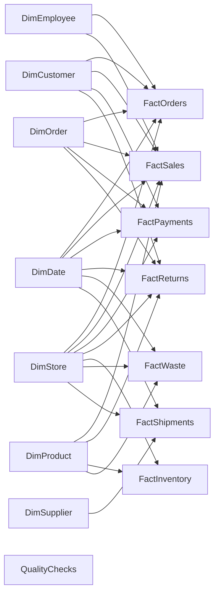

# Food Retail Operations Analytics | Power BI

An interactive, multi-page Power BI report project for exploring food retail sales, products, stores, customers, inventory, payments, returns, waste, and shipments. The project also demonstrates data preparation, dimensional modeling, DAX measures, and data-quality checks.

**Suggested GitHub repository name:** `food-retail-powerbi-analytics`

## Project overview

The report is designed around separate transaction facts and shared dimensions. This makes it possible to analyze each business process at its own level of detail while using shared product, customer, store, date, and order filters.

The supplied sample data needs validation before its values can be treated as company results. The report labels source amounts clearly and includes a data-quality page so users can see the known limitations.

## Report pages

The report design has six visible pages and two supporting pages:

1. **Overview** — selected activity measures, daily trend, source-category comparison, and store ranking.
2. **Sales & Products** — product rankings, daily units, and a category-to-product matrix.
3. **Stores & Customers** — store and customer activity with an order comparison table.
4. **Stock, Waste & Returns** — inventory extract, waste and returns, and related limitations.
5. **Payments & Shipments** — recorded payments, shipment records, and shipment date checks.
6. **Data Quality** — selected reconciliation and chronology checks with metric definitions.
7. **Order Detail** *(hidden)* — order lines, payments, and returns, reached through drillthrough.
8. **Product Tooltip** *(hidden)* — selected product measures and their definitions.

## Data model

The semantic model uses dimensions for filtering and facts for transaction activity. Relationships are designed as one-to-many, single-direction filters from dimensions to facts.



`QualityChecks` is a disconnected summary table. `FactInventory` is not related to `DimDate` because the sample does not provide a reliable inventory snapshot date. `FactSales` contains order-line data; order-header totals remain in `FactOrders` to avoid counting an order total once for each line.

### Model tables

**Dimensions:** `DimDate`, `DimProduct`, `DimCustomer`, `DimStore`, `DimEmployee`, `DimSupplier`, `DimOrder`.

**Facts:** `FactOrders`, `FactSales`, `FactPayments`, `FactReturns`, `FactInventory`, `FactWaste`, `FactShipments`.

**Quality summary:** `QualityChecks`.

## Example measures

```dax
Recorded Units Sold =
SUM ( FactSales[Quantity] )

Calculated Gross Line Value =
SUMX (
    FactSales,
    FactSales[Quantity] * FactSales[UnitPrice]
)

Orders With Selected Products =
DISTINCTCOUNT ( FactSales[OrderID] )

Weighted Line Unit Price =
DIVIDE (
    [Calculated Gross Line Value],
    [Recorded Units Sold]
)
```

These measures describe the supplied fields. They are not, by themselves, validated net sales, profit, or cash collection measures.

## Data quality and interpretation

The source archive contains 15 CSV files, each with 1,200 rows and 10 columns. The inspected transaction dates span January 1–28, 2025. The data contains no blank cells or duplicate primary IDs in the inspected files, but several business fields and cross-table comparisons need correction.

Examples of issues found:

- Tax, discount, rating, reorder-level, and waste-cost columns contain text in place of numbers.
- Every order header amount differs from the calculated gross value of its order lines.
- 589 return records have a quantity greater than the sold quantity on the matching order and product.
- 577 returns are dated before their corresponding order.
- 596 shipments arrive before their shipping date.
- The product category labels do not match the supplied Categories table.
- The inventory `LastUpdated` field is not a valid date.

The report therefore uses explicit names such as **Recorded Order Amount** and **Calculated Gross Line Value**. Currency is unspecified. The sample does not support dependable profit, customer-retention, promotion-ROI, inventory-turnover, or year-over-year reporting.

## Tools and techniques

- Power BI Desktop
- Power Query for import, cleaning, type conversion, references, and merges
- DAX for measures, calculated labels, date fields, and quality checks
- Star-schema modeling with shared dimensions and separate fact tables
- Matrix visuals, slicers, drillthrough, report-page tooltips, bookmarks, and page navigation

## Getting started

1. Install Power BI Desktop.
2. Extract the source CSV files to a local data folder.
3. In Power BI Desktop, open the `.pbix` file from this project. If it is not included, create a new PBIX and follow the report build guide.
4. In Power Query, set the `pDataFolder` parameter to the folder containing the extracted CSV files.
5. Refresh the queries, then confirm that the prepared tables load and the relationship diagram matches the model above.
6. Review the data-quality page before interpreting any business figures.

## Suggested repository layout

```text
food-retail-powerbi-analytics/
├── README.md
├── report/
│   └── Food_Retail_Report.pbix
├── docs/
│   └── Power_BI_build_guide.md
├── screenshots/
│   ├── overview.png
│   └── data-quality.png
└── data/
    └── (optional, only if the data is cleared for sharing)
```


