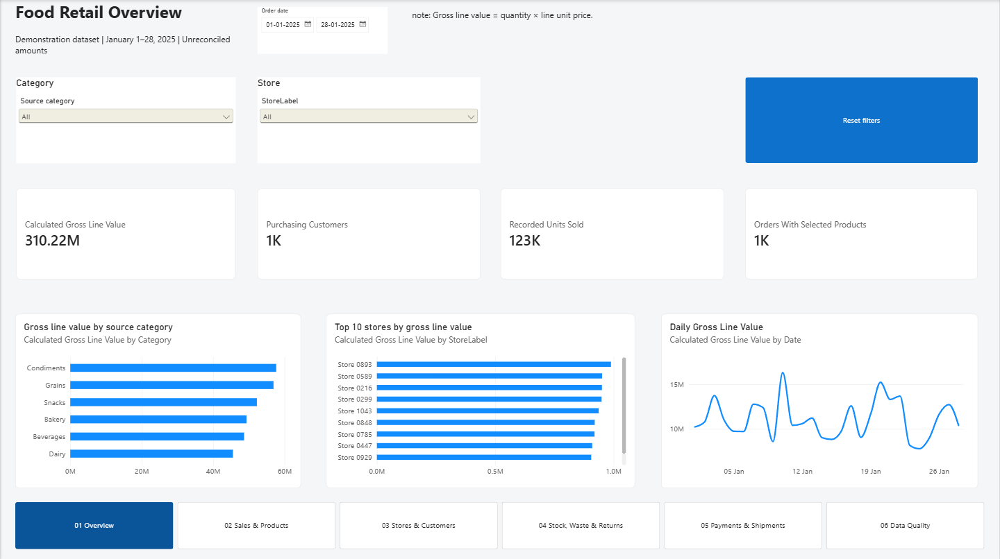
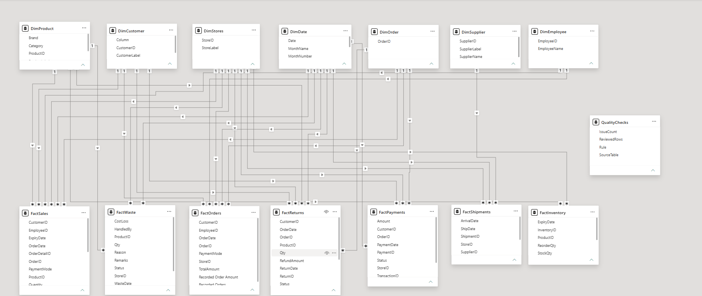

# Food Retail Operations Analytics | Power BI

An interactive Power BI project for exploring food retail sales, products, stores, customers, inventory, payments, returns, waste, and shipments.

**GitHub repository name:** `food-retail-powerbi-analytics`

## Dashboard preview



This is a layout illustration. It intentionally contains no business KPI values.

## Data model



The model uses shared dimensions and separate fact tables. Relationships filter from dimensions to facts using a one-to-many pattern. Inventory has no date relationship because the sample does not contain a reliable snapshot date. Order header totals remain separate from sales lines to prevent double-counting.

**Dimensions:** `DimDate`, `DimProduct`, `DimCustomer`, `DimStore`, `DimEmployee`, `DimSupplier`, `DimOrder`.

**Facts:** `FactOrders`, `FactSales`, `FactPayments`, `FactReturns`, `FactInventory`, `FactWaste`, `FactShipments`.

**Quality summary:** `QualityChecks` (disconnected from the business model).

## Report pages

1. **Overview** — activity measures, daily trend, category comparison, and store ranking.
2. **Sales & Products** — product rankings, daily units, and product matrix.
3. **Stores & Customers** — activity by store and customer, with order detail access.
4. **Stock, Waste & Returns** — inventory extract and recorded waste and return activity.
5. **Payments & Shipments** — payment records, shipment records, and date checks.
6. **Data Quality** — selected reconciliation checks and metric definitions.
7. **Order Detail** *(hidden)* — sales lines, payments, and returns reached through drillthrough.
8. **Product Tooltip** *(hidden)* — selected product metrics and definitions.

## Example DAX measures

```dax
Recorded Units Sold =
SUM ( FactSales[Quantity] )

Calculated Gross Line Value =
SUMX (
    FactSales,
    FactSales[Quantity] * FactSales[UnitPrice]
)

Orders With Selected Products =
DISTINCTCOUNT ( FactSales[OrderID] )

Weighted Line Unit Price =
DIVIDE (
    [Calculated Gross Line Value],
    [Recorded Units Sold]
)
```

These measures describe source fields. They should not be interpreted as validated net sales, profit, or successful cash collection.

## Dataset and limitations

The supplied archive contains 15 CSV files, each with 1,200 rows and 10 columns. The inspected transaction dates cover January 1–28, 2025. The files have no blank cells or duplicate primary IDs in the inspected data, but multiple fields and business rules need correction.

- Tax, discount, rating, reorder-level, and waste-cost fields contain text where numeric values are expected.
- Every order header amount differs from the calculated gross value of its order lines.
- 589 returns exceed the sold quantity for the matching order and product.
- 577 returns are dated before their corresponding orders.
- 596 shipments arrive before their shipping date.
- Product category labels do not match the supplied Categories table.
- The inventory `LastUpdated` field does not contain valid dates.
- Currency is unspecified, and the sample covers less than one month.

For these reasons, the report labels measures as recorded source amounts and includes a data-quality page. Profit, customer retention, promotion ROI, inventory turnover, and year-over-year performance are not supported by this extract.

## Tools

- Power BI Desktop
- Power Query for importing, profiling, cleaning, typing, referencing, and merging data
- DAX for measures, labels, date fields, and quality checks
- Dimensional modeling with shared dimensions and separate facts
- Matrix visuals, slicers, drillthrough, report-page tooltips, bookmarks, and page navigation

## Getting started

1. Install Power BI Desktop.
2. Extract the CSV files to a local folder.
3. Open the project `.pbix` file. If it is not included yet, create a PBIX and follow the model and report build instructions.
4. In Power Query, set the `pDataFolder` parameter to the extracted CSV folder.
5. Refresh the queries and confirm the model relationships.
6. Review the Data Quality page before interpreting any figures.


